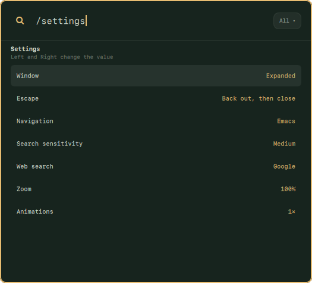

> **NobleRunner** is a fork of [omacast](https://github.com/typecraft-dev/oma-cast) by typecraft (MIT, see `LICENSE`).
> Plugin id `nobledoodle.noblerunner`, command `noblerunner`, data under `~/.config`, `~/.local/share`,
> `~/.cache` and `~/.local/state` in `noblerunner`. Directories left by omacast move to those names on first start.

<div align="center">


# noblerunner

**A Raycast-esque launcher for [Omarchy](https://omarchy.org).**
It learns what you use, searches your apps and every Omarchy action, and looks like it shipped with your theme.


</div>

---

## Why

Omarchy's built-in menu is great at what it does. noblerunner adds what Raycast users miss on Linux:

* **Learns your habits.** Results are ranked with a port of Raycast's root-search algorithm, plus frecency and learned search terms. The things you actually use float to the top, and if you type `ff` and pick Firefox, `ff` keeps meaning Firefox.
* **One search for everything.** Your apps, all ~400 Omarchy menu actions (with breadcrumbs and live ✓ state), and web-search fallbacks.
* **Your shortcuts.** Give anything an alias, pin favorites, and hide the commands you never touch.
* **Keyboard-first.** A Ctrl+K action panel, Ctrl+1–9 quick picks, search history on ↑, section jumping, and emacs-style navigation.
* **Superwhisper.** Dictate into the open bar. The words land in the search field, and Superwhisper's own glow sits along the bottom edge of the card. This is only active when Superwhisper is installed.
* **Native to Omarchy.** It runs inside `omarchy-shell` as a plugin, with no Electron, no Node and no extra daemons. It opens in about 40 ms and follows your theme live when you run `omarchy theme set`.

## Screenshots

<table>
  <tr>
    <td width="50%"></td>
    <td width="50%"></td>
  </tr>
  <tr>
    <td align="center"><b>Every Omarchy action, with breadcrumbs</b></td>
    <td align="center"><b>Ctrl+K: actions for any result</b></td>
  </tr>
  <tr>
    <td width="50%"></td>
    <td width="50%"></td>
  </tr>
  <tr>
    <td align="center"><b>Opens on your apps and Omarchy actions</b></td>
    <td align="center"><b>No match? Send the query to your default web search</b></td>
  </tr>
</table>

### Follows your Omarchy theme

There's no theme config. noblerunner binds to Omarchy's own colors and to your Hyprland window border, so it changes the moment you switch themes.


## Install

Requires Omarchy with `omarchy-shell`. Install the plugin, then run its setup script:

```bash
omarchy plugin add https://github.com/NobleDoodle/noblerunner --enable
~/.config/omarchy/plugins/nobledoodle.noblerunner/install.sh
```

The first command is the normal Omarchy plugin install. The second checks that
`omarchy-shell`, `socat`, `jq` and `hyprctl` are present, links the `noblerunner`
command into `~/.local/bin`, builds the optional search helper when Rust
is installed, and then asks which key should open the launcher. It does not
install packages. A missing required command stops the script and names the
package. Missing Rust is a warning: search still works with the built-in matcher.

### Choosing the hotkey

Run in a terminal, `install.sh` ends with this question:

```text
Which key should open noblerunner?

  1) Alt+Space    the usual launcher key
                  now used by: Toggle dictation (noblerunner would take it over)
  2) Super        tap the Super key by itself; holding it for another shortcut does nothing
  3) Super+Space  takes the Omarchy menu's key; the menu stays in noblerunner as "Omarchy Menu"
                  now used by: Omarchy menu (noblerunner would take it over)
  4) Off          no hotkey; open it with: noblerunner toggle

Choose 1-4 [1]:
```

1. Type a number and press Enter. Enter by itself takes the choice in brackets:
   Alt+Space on a new install, your current key after that.
2. A `now used by` line appears under a key that already does something on your
   machine. Omarchy puts dictation on Alt+Space when a dictation program is
   installed, and its menu on Super+Space.
3. The script lists what it will change. If your choice takes a key from
   something else, or replaces a `noblerunner.lua` you wrote yourself, it asks
   once more before changing anything. A file of your own is first copied to
   `noblerunner.lua.bak-<date>` next to it.
4. Hyprland reloads and the key works at once.

The hotkey is one file, `~/.config/hypr/noblerunner.lua`, plus one
`require("hypr.noblerunner")` line at the end of `~/.config/hypr/hyprland.lua`.
Omarchy's own files are never edited. The file unbinds the key it takes and
then binds the launcher, so removing the file gives the key back.

Change the key later by asking again, or set it without questions:

```bash
noblerunner setup hyprland                      # the same question
noblerunner setup hyprland --key=super --yes    # alt-space | super | super-space | off
```

`install.sh --hotkey=super` (or `alt-space`, `super-space`, `off`) answers the
question up front, and `install.sh --no-hotkey` skips it. Run without a
terminal, the script does not ask and leaves the hotkey alone.

noblerunner stays loaded in the shell, so if the launcher does not appear
after the first install, restart the shell once with `omarchy-restart-shell`.

Update the plugin with `omarchy plugin update nobledoodle.noblerunner`, then
run `install.sh` again so the command link and search helper match the new
files.

### Remove

```bash
~/.config/omarchy/plugins/nobledoodle.noblerunner/uninstall.sh --remove-plugin
```

This also deletes `~/.config/hypr/noblerunner.lua` and its `require` line, so
a key the launcher took goes back to what it did before. If you remove the
plugin with `omarchy plugin remove` instead, run
`noblerunner setup hyprland --key=off --yes` first, or delete that file and
line yourself. Your settings and history stay in `~/.config/noblerunner`,
`~/.local/share/noblerunner`, `~/.cache/noblerunner` and
`~/.local/state/noblerunner` until you delete them.

### Dependencies and network access

`install.sh` requires `omarchy-shell`, `socat` and `jq`, which Omarchy
already provides, and `hyprctl` for the hotkey. It adds no packages and no
background services.

- **Currency rates.** When you open the launcher and its rates are over 12 hours old, the calculator downloads
  ECB exchange rates from `api.frankfurter.dev` (retrying 30 minutes after a failure) and caches them in
  `~/.cache/noblerunner/currencies.json`. This is the only network request noblerunner makes. Turn it off with
  `"currencyRates": false` in `~/.config/noblerunner/config.json`.
- **Optional search helper.** With Rust (`cargo`) installed, `noblerunner install` (or `noblerunner build-search`)
  builds the small **flea-search** helper from `search/` on your machine. It matches titles, alternate names,
  subtitles and keywords outside the shell's UI thread and tolerates transposed or missing letters. Nothing is
  downloaded prebuilt. Without it, noblerunner uses the built-in matcher, so a marketplace install works without
  Rust. Aliases, favorites, learned terms and frecency stay in noblerunner's ranker either way. If the helper fails
  or times out, search falls back to the built-in matcher until the plugin reloads. Rebuild it after
  `omarchy plugin update`.

- **Blur.** noblerunner asks Hyprland to blur what is behind its card. It shows when your menu background is
  see-through (`background-alpha` below 1 under `[menu]` in `~/.config/omarchy/shell.toml`); with Omarchy's
  default opaque menu the card looks the same as before.
- **Superwhisper glow.** When Superwhisper is installed, the launcher opens an invisible window behind its
  card while it is open, because Superwhisper draws its glow on the focused window. noblerunner adds a
  Hyprland rule for that one window so it has no border or blur. Turn it off with `"superwhisperGlow": false`
  in `~/.config/noblerunner/config.json`. Without Superwhisper none of this happens.

### Privacy

Your search history, learned search terms and calculator history stay on your machine, in owner-only
files: noblerunner creates its `~/.config`, `~/.local/share`, `~/.cache` and `~/.local/state` directories as
`0700` and its database files as `0600`, and tightens any it finds readable by other users. Text you copy
or paste from the calculator goes to `wl-copy` on stdin, never on a command line, so other local users
can't read it from the process list. Paste sends Shift+Insert after copying, as Omarchy's clipboard history does.
A web search is the exception: the search address, with your query in it, is handed to your browser as a
command-line argument, which is how a browser is given a page to open.

### Upgrading from omacast

The plugin used to be `typecraft.omacast`. On first start, noblerunner moves your `omacast` config, data,
cache and state directories to the `noblerunner` names. In a development checkout, `bin/noblerunner install` removes
the old plugin link and `~/.local/bin/omacast`, and `noblerunner setup hyprland` moves `omacast.lua` to
`noblerunner.lua`, keeping your key. `noblerunner doctor` reports anything left over.

## Settings

Settings live inside the launcher. There is no separate window.

<p align="center">
  
</p>

1. Open noblerunner and type `/settings`. `/s` is enough.
2. Move between rows with `↑` and `↓` (or your navigation keys).
3. Change the selected row with `→` or `↵`. `←` goes the other way. A click on a row also steps it forward.
4. Each change applies and saves as you make it. There is nothing to confirm.
5. Clear the search field or press `Esc` to go back to searching.

| Row | Values | What it does |
|---|---|---|
| Window | Expanded, Compact | Expanded opens with the full list. Compact opens as the search bar alone and grows when you type. |
| Escape | Back out, then close · Close and return to root | The first clears the query, then steps back a level, then closes. The second closes at once. `Shift+Esc` returns to the root without closing. |
| Navigation | Emacs, Vim | Emacs moves down with `Ctrl+N` (`Ctrl+P` moves up inside panels and opens the filter in the list). Vim moves with `Ctrl+J` / `Ctrl+K` and puts the action panel on `Alt+K`. |
| Search sensitivity | Low, Medium, High | How close a result must be to what you typed. Low shows every loose match, High only the strong ones. |
| Web search | Google, DuckDuckGo, Brave, Bing, Startpage, Ecosia | The search engine offered when nothing matches. |
| Zoom | 80% to 150% | Size of the launcher, in steps of 10%. `Ctrl +`, `Ctrl −` and `Ctrl 0` change it from anywhere. |
| Animations | Off, 0.5×, 1×, 1.5×, 2× | Speed of the open, close and expand motion. 2× is twice as fast. |

Settings are stored in `~/.local/share/noblerunner/db/settings.json`. The same values can be set from a
terminal, for example `noblerunner call settings.updateGeneralSettings '{"webSearch":"duckduckgo"}'`.

A few options that rarely change are in `~/.config/noblerunner/config.json` (create it if it is missing):

| Key | Default | What it does |
|---|---|---|
| `currencyRates` | `true` | Download ECB exchange rates for the calculator. |
| `superwhisperGlow` | `true` | Show Superwhisper's glow on the card when Superwhisper is installed. |
| `keepVisibleOnFocusLoss` | `false` | Keep the launcher open when you click outside it. |
| `scrollSpeed` | `1` | Scroll speed of the lists, on the touchpad and the mouse wheel (three rows per notch at 1). 2 is twice as fast. A quick touchpad swipe keeps coasting after you lift your fingers. |
| `clockFormat` | `"auto"` | `"12h"` or `"24h"` for times in calculator answers. |
| `remToPxRate` | `16` | Pixels per rem in unit conversions. |
| `workHoursPerDay` | `8` | Hours in a work day for work-time conversions. |
| `logLevel` | `"info"` | How much noblerunner writes to the shell log. |

## Keyboard

| Key | Does |
|---|---|
| `↵` / `Ctrl+↵` / `Ctrl+Shift+↵` | Run the first, second or third action |
| `Shift+↵` | Open a new window of an app (`↵` switches to the one already open) |
| `Ctrl+K` | Open the action panel |
| `/settings` | Open the settings panel |
| `Super+V` / `Ctrl+V` / `Ctrl+Shift+V` / `Shift+Insert` | Paste text into the query (also accepts clipboard-history selections) |
| `Ctrl+1`…`9` | Pick a result |
| `↑` on an empty search | Search history |
| `Ctrl+↑` / `Ctrl+↓` | Jump between sections |
| `Ctrl+N` / `Ctrl+P` | Next / previous |
| `Ctrl+Shift+F` | Add to favorites (`Ctrl+Alt+↑↓` to reorder) |
| `Ctrl+Shift+C` | Copy |
| `Alt+Shift+D` | Disable a command |
| `Esc` / `Shift+Esc` | Back / back to root |
| `Ctrl +` / `Ctrl −` / `Ctrl 0` | Zoom |

## CLI

```sh
noblerunner toggle | show | hide
noblerunner run <commandId>         # e.g. app:com.mitchellh.ghostty, omarchy:appearance.theme
noblerunner call <method> [json]    # call any backend method
noblerunner doctor
```

## Roadmap

noblerunner is early. Search, ranking, the calculator, in-launcher settings and the Omarchy integration are done. Coming next:

- [ ] Script Commands
- [ ] Clipboard history, snippets, quicklinks
- [ ] Running Raycast extensions built from the open-source [`raycast/extensions`](https://github.com/raycast/extensions) repo
- [ ] Window management
- [ ] Importing your `.rayconfig` from macOS

The full plan is in [`SPEC.md`](SPEC.md).

## Development

```sh
git clone https://github.com/NobleDoodle/noblerunner.git
cd noblerunner
bin/noblerunner install         # symlink this checkout into omarchy-shell instead of a marketplace copy
node --test tests/*.test.js # unit tests, no npm install needed
tests/smoke.sh              # live checks against the running shell
noblerunner dev                 # reload on every save
```

Remove a marketplace install first (`omarchy plugin remove nobledoodle.noblerunner`); both use the same plugin id.
Quickshell caches QML for the life of the process, so run `noblerunner reload` after editing a checkout. See [`CLAUDE.md`](CLAUDE.md) for the layout and conventions.

## Notes

noblerunner is an independent, clean-room project. It isn't affiliated with or endorsed by Raycast, and it contains no Raycast code or assets. It never contacts Raycast's servers and has no telemetry. It has no embedded AI features.
