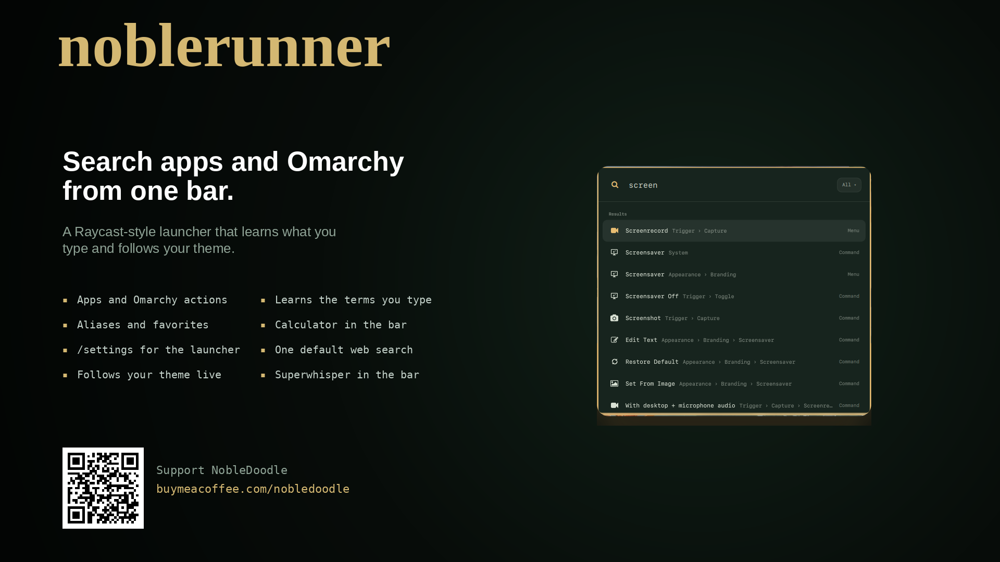
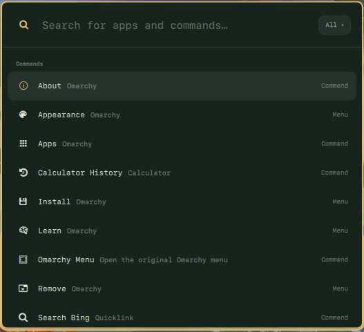
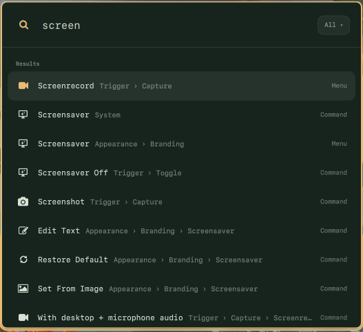
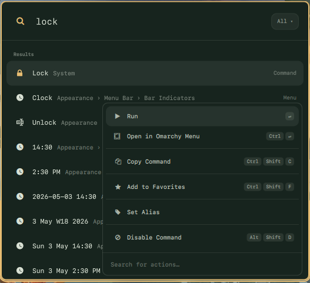
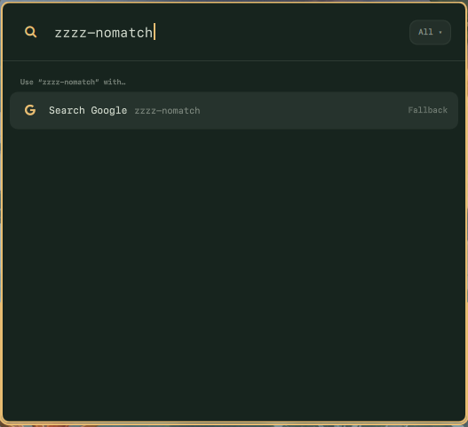
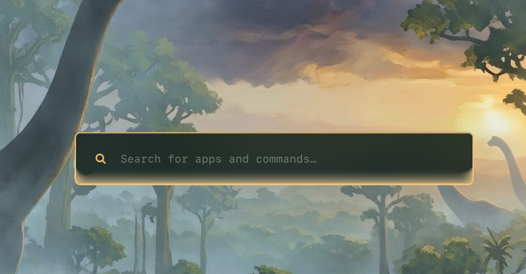
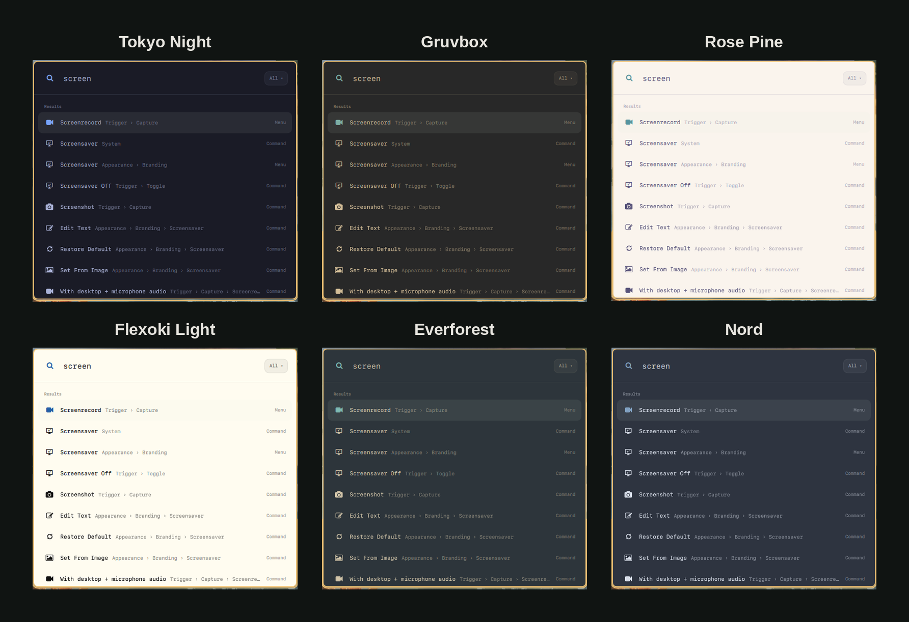

> **NobleRunner** is a fork of [omacast](https://github.com/typecraft-dev/oma-cast) by typecraft (MIT, see `LICENSE`).
> Plugin id `nobledoodle.noblerunner`, command `noblerunner`, data under `~/.config`, `~/.local/share`,
> `~/.cache` and `~/.local/state` in `noblerunner`. Directories left by omacast move to those names on first start.

<div align="center">



# noblerunner

**A Raycast-esque launcher for [Omarchy](https://omarchy.org).**
It learns what you use, searches your apps and every Omarchy action, and looks like it shipped with your theme.



</div>

---

## Why

Omarchy's built-in menu is great at what it does. noblerunner adds what Raycast users miss on Linux:

* **Learns your habits.** Results are ranked with a port of Raycast's root-search algorithm, plus frecency and learned search terms. The things you actually use float to the top, and if you type `ff` and pick Firefox, `ff` keeps meaning Firefox.
* **One search for everything.** Your apps, all ~400 Omarchy menu actions (with breadcrumbs and live ✓ state), and web-search fallbacks.
* **Your shortcuts.** Give anything an alias, pin favorites, and hide the commands you never touch.
* **Keyboard-first.** A Ctrl+K action panel, Ctrl+1–9 quick picks, search history on ↑, section jumping, and emacs-style navigation.
* **Superwhisper.** Dictate into the open bar. The words land in the search field, and Superwhisper's own glow sits along the bottom edge of the card.
* **Native to Omarchy.** It runs inside `omarchy-shell` as a plugin, with no Electron, no Node and no extra daemons. It opens in about 40 ms and follows your theme live when you run `omarchy theme set`.

## Screenshots

<table>
  <tr>
    <td width="50%"></td>
    <td width="50%"></td>
  </tr>
  <tr>
    <td align="center"><b>Every Omarchy action, with breadcrumbs</b></td>
    <td align="center"><b>Ctrl+K: actions for any result</b></td>
  </tr>
</table>

<p align="center">
  
</p>
<p align="center"><b>No match? Send the query to your default web search</b></p>

<p align="center">
  
</p>
<p align="center"><b>Superwhisper dictates into the bar. Its glow sits on the bottom edge.</b></p>

### Follows your Omarchy theme

There's no theme config. noblerunner binds to Omarchy's own colours, so it changes the moment you switch themes.



## Install

Requires Omarchy with `omarchy-shell`. Install the plugin, then run its setup script:

```bash
omarchy plugin add https://github.com/NobleDoodle/noblerunner --enable
~/.config/omarchy/plugins/nobledoodle.noblerunner/install.sh
```

The first command is the normal Omarchy plugin install. The second checks that
`omarchy-shell`, `socat`, `jq` and `hyprctl` are present, links the `noblerunner`
command into `~/.local/bin`, and builds the optional search helper when Rust
is installed. It does not install packages. A missing required command stops
the script and names the package. Missing Rust is a warning: search still
works with the built-in matcher.

Bind a hotkey in the same script with `--hotkey`. That writes
`~/.config/hypr/noblerunner.lua` for Alt+Space and adds one
`require("hypr.noblerunner")` line to `~/.config/hypr/hyprland.lua`. If
Alt+Space is already used, the hotkey step is skipped and the rest of the
install still finishes. An existing `noblerunner.lua` is kept. To choose
another key, edit that file. Super+Space stays the Omarchy menu.

```bash
~/.config/omarchy/plugins/nobledoodle.noblerunner/install.sh --hotkey
```

noblerunner stays loaded in the shell, so if the launcher does not appear
after the first install, restart the shell once with `omarchy-restart-shell`.

Update the plugin with `omarchy plugin update nobledoodle.noblerunner`, then
run `install.sh` again so the command link and search helper match the new
files.

### Remove

```bash
~/.config/omarchy/plugins/nobledoodle.noblerunner/uninstall.sh --remove-plugin
```

Add `--hotkey` to also delete `~/.config/hypr/noblerunner.lua` and its
`require` line. Your settings and history stay in `~/.config/noblerunner`,
`~/.local/share/noblerunner`, `~/.cache/noblerunner` and
`~/.local/state/noblerunner` until you delete them.

### Dependencies and network access

`install.sh` requires `omarchy-shell`, `socat` and `jq`, which Omarchy
already provides, and `hyprctl` for the hotkey. It adds no packages and no
background services.

- **Currency rates.** When you open the launcher and its rates are over 12 hours old, the calculator downloads
  ECB exchange rates from `api.frankfurter.dev` (retrying 30 minutes after a failure) and caches them in
  `~/.cache/noblerunner/currencies.json`. This is the only network request noblerunner makes. Turn it off with
  `"currencyRates": false` in `~/.config/noblerunner/config.json`.
- **Optional search helper.** With Rust (`cargo`) installed, `noblerunner install` (or `noblerunner build-search`)
  builds the small **flea-search** helper from `search/` on your machine. It matches titles, alternate names,
  subtitles and keywords outside the shell's UI thread and tolerates transposed or missing letters. Nothing is
  downloaded prebuilt. Without it, noblerunner uses the built-in matcher, so a marketplace install works without
  Rust. Aliases, favorites, learned terms and frecency stay in noblerunner's ranker either way. If the helper fails
  or times out, search falls back to the built-in matcher until the plugin reloads. Rebuild it after
  `omarchy plugin update`.

### Privacy

Your search history, learned search terms and calculator history stay on your machine, in owner-only
files: noblerunner creates its `~/.config`, `~/.local/share`, `~/.cache` and `~/.local/state` directories as
`0700` and its database files as `0600`, and tightens any it finds readable by other users. Text you copy
or paste from the calculator goes to `wl-copy` on stdin, never on a command line, so other local users
can't read it from the process list. Paste sends Shift+Insert after copying, as Omarchy's clipboard history does.

### Upgrading from omacast

The plugin used to be `typecraft.omacast`. On first start, noblerunner moves your `omacast` config, data,
cache and state directories to the `noblerunner` names. In a development checkout, `bin/noblerunner install` removes
the old plugin link and `~/.local/bin/omacast`, and `noblerunner setup hyprland` moves `omacast.lua` to
`noblerunner.lua`, keeping your key. `noblerunner doctor` reports anything left over.

## Keyboard

| Key | Does |
|---|---|
| `↵` / `Ctrl+↵` / `Ctrl+Shift+↵` | Run the first, second or third action |
| `Shift+↵` | Open a new window of an app (`↵` switches to the one already open) |
| `Ctrl+K` | Open the action panel |
| `Super+V` / `Ctrl+V` / `Ctrl+Shift+V` / `Shift+Insert` | Paste text into the query (also accepts clipboard-history selections) |
| `Ctrl+1`…`9` | Pick a result |
| `↑` on an empty search | Search history |
| `Ctrl+↑` / `Ctrl+↓` | Jump between sections |
| `Ctrl+N` / `Ctrl+P` | Next / previous |
| `Ctrl+Shift+F` | Add to favorites (`Ctrl+Alt+↑↓` to reorder) |
| `Ctrl+Shift+C` | Copy |
| `Alt+Shift+D` | Disable a command |
| `Esc` / `Shift+Esc` | Back / back to root |
| `Ctrl +` / `Ctrl −` / `Ctrl 0` | Zoom |

## CLI

```sh
noblerunner toggle | show | hide
noblerunner run <commandId>         # e.g. app:com.mitchellh.ghostty, omarchy:appearance.theme
noblerunner call <method> [json]    # call any backend method
noblerunner doctor
```

## Roadmap

noblerunner is early. Search, ranking and the Omarchy integration are done. Coming next:

- [ ] Settings window
- [ ] Script Commands
- [ ] Clipboard history, snippets, quicklinks, calculator
- [ ] Running Raycast extensions built from the open-source [`raycast/extensions`](https://github.com/raycast/extensions) repo
- [ ] Window management
- [ ] Importing your `.rayconfig` from macOS

The full plan is in [`SPEC.md`](SPEC.md).

## Development

```sh
git clone https://github.com/typecraft-dev/oma-cast.git
cd omacast
bin/noblerunner install         # symlink this checkout into omarchy-shell instead of a marketplace copy
node --test tests/*.test.js # unit tests, no npm install needed
tests/smoke.sh              # live checks against the running shell
noblerunner dev                 # reload on every save
```

Remove a marketplace install first (`omarchy plugin remove nobledoodle.noblerunner`); both use the same plugin id.
Quickshell caches QML for the life of the process, so run `noblerunner reload` after editing a checkout. See [`CLAUDE.md`](CLAUDE.md) for the layout and conventions.

## Notes

noblerunner is an independent, clean-room project. It isn't affiliated with or endorsed by Raycast, and it contains no Raycast code or assets. It never contacts Raycast's servers and has no telemetry. Its agent action explicitly hands your question to Omarchy's existing coding-agent launcher; it provides no embedded AI runtime.
